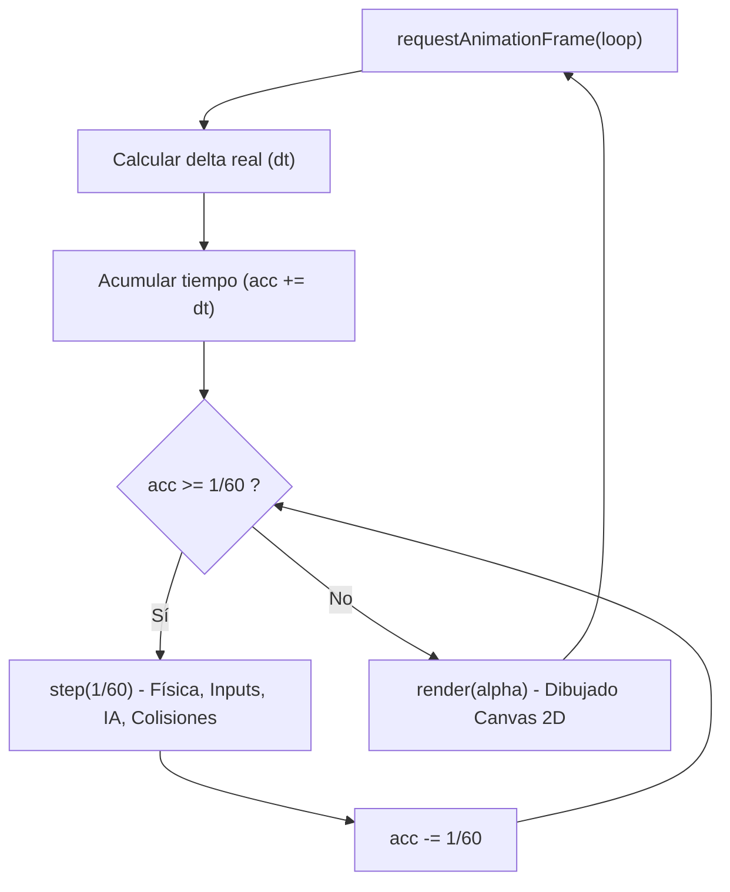
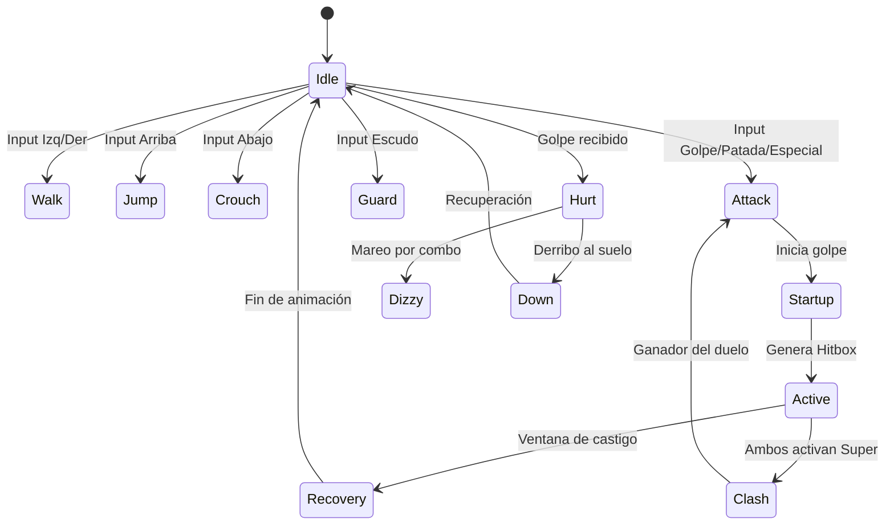

# Manchester FISI Fighter — vJHOE1.0

> **Juego de lucha 2D arcade de 16 bits desarrollado con tecnologías web estándar (HTML5 Canvas 2D, Web Audio API y JavaScript modular).**  
> Proyecto ambientado en la Facultad de Ingeniería de Sistemas e Informática (FISI) de la Universidad Nacional de San Martín (UNSM, Tarapoto).

🎮 **[Jugar en línea en GitHub Pages]**  
📦 **HTML Autónomo:** Abre directamente `outputs/Manchester-FISI-Fighter-v0.11.html` (114.3 MB, contiene todos los sprites, atlas y audios integrados en un único archivo sin necesidad de servidor web).

---

## Índice

1. [Estructura y Organización de Archivos](#1-estructura-y-organización-de-archivos)
2. [Arquitectura del Motor de Juego](#2-arquitectura-del-motor-de-juego)
   - [Ciclo Principal (Game Loop & Tasa Fija a 60 FPS)](#game-loop-y-tasa-fija-a-60-fps)
   - [Máquina de Estados Global de la Aplicación](#máquina-de-estados-global)
   - [Motor de Combate y Simulación Física](#motor-de-combate-y-simulación-física)
   - [Pipeline de Renderizado Canvas 2D y Normalización Gráfica](#pipeline-de-renderizado-canvas-2d)
   - [Subsistema de Audio y Voces](#subsistema-de-audio-y-voces)
   - [Sistema de Entrada (Input Handling & Gamepads)](#sistema-de-entrada)
3. [Roster de Personajes (9 Luchadores)](#3-roster-de-personajes-9-luchadores)
4. [Escenarios (10 Arenas del Campus)](#4-escenarios-10-arenas-del-campus)
5. [Modos de Juego](#5-modos-de-juego)
6. [Controles y Combinaciones](#6-controles-y-combinaciones)
7. [Guía de Compilación y Despliegue](#7-guía-de-compilación-y-despliegue)

---

## 1. Estructura y Organización de Archivos

El proyecto sigue una arquitectura web desacoplada y estandarizada en carpetas especializadas:

```
manchester_fighter_fisi/
├── index.html                   # Punto de entrada HTML5 y lienzo principal (960x540)
├── build.cjs                    # Script empaquetador a HTML monolítico autónomo en Base64
├── README.md                    # Documentación arquitectónica completa del proyecto
├── DIAGNOSTICO-PROYECTO-Y-ESCALADO.md # Diagnóstico técnico exhaustivo y resolución de bugs
│
├── js/                          # Módulos JavaScript del juego
│   ├── asset-catalog.js         # Catálogo de metadatos de luchadores, stages y poses
│   ├── game-v4.js               # Núcleo del motor: ciclo principal, colisiones y estados
│   ├── combat-refinements.js    # Choque de ultis (Power Clash), normalización de escalas
│   ├── sprite-scaling.js        # Normalización geométrica visual y recorte dinámico
│   ├── audio-director.js        # Sintetizador procedural Web Audio API (efectos de sonido)
│   ├── battle-audio.js          # Gestor de streaming y precarga de pistas de voz para Batalla
│   ├── battle-mode.js           # Lógica de progresión y reglas de la campaña narrativa
│   ├── battle-scenes.js         # Cinemáticas, diálogos interactivos y escena de campeón
│   ├── fighter-updates.js       # Comportamientos específicos v0.8 (Kike, Cárdenas, Pepelucho)
│   ├── fiel-updates.js          # Movimientos de El Fiel v0.10 (cuchillo, polo, voltereta)
│   ├── lancha-updates.js        # Movimientos de Lancha v0.9 (lanzamiento de bala, rodada)
│   ├── grab-updates.js          # Sistema de agarres fluidos v0.11 (Lancha y El Fiel)
│   ├── pingordy-animation.js    # Atlas unificado de Pingordy (101 frames y paso lunar)
│   ├── portrait-photos.js       # Integración de fotos reales de alta definición
│   ├── random-selection.js      # Algoritmo de selección aleatoria de personajes y escenarios
│   ├── versus-options.js        # Menú de configuración VS (1 a 5 barras de vida, paletas)
│   ├── visual-polish.js         # Efectos visuales de impacto (anillos, chispas y destellos)
│   ├── frontend.js              # Interfaz de usuario previa al combate (menú principal)
│   ├── presentation.js          # Intro cinematográfica con créditos y cartel de luchadores
│   └── exit-confirmation.js     # Modal de confirmación para abandonar la pelea en curso
│
├── css/                         # Hojas de estilo modulares
│   ├── style.css                # Estilos base, reset tipográfico y lienzo
│   ├── combat-v3.css            # Barras de vida, medidores de energía y contadores HUD
│   ├── battle-mode.css          # Interfaz visual del modo Batalla (diálogos y mapa)
│   ├── frontend.css             # Menú principal, selector de luchadores y pantallas arcade
│   ├── presentation.css         # Tarjetas de presentación y carteles de escena
│   ├── random-selection.css     # Estilos visuales de la ruleta aleatoria
│   ├── responsive.css           # Escalado responsive para pantallas móviles y escritorios
│   └── fighter-updates.css      # Ajustes CSS específicos para efectos de personajes
│
├── assets/                      # Recursos multimedia crudos
│   ├── personajes/              # Spritesheets, PNGs y retratos de los 9 luchadores
│   ├── escenarios/              # Fondos panorámicos de las 10 locaciones
│   ├── interfaz/                # Logotipos, insignias y escudos institucionales
│   ├── publico/                 # Espectadores animados del campus
│   └── audio/                   # Efectos de voz y diálogos de campaña (.mp3)
│
├── docs/                        # Documentación técnica histórica y de diseño
│   ├── AGARRES-0.11.md          # Especificación del sistema de agarres de la versión 0.11
│   ├── DIALOGOS-BATALLA.json    # Transcripciones completas de los combates narrativos
│   ├── ARTE.md                  # Especificaciones artísticas y paletas cromáticas
│   └── ASSETS.md                # Bitácora de recursos multimedia del proyecto
│
├── scripts/                     # Herramientas de automatización y verificación
│   ├── apply-fixes.cjs          # Script de aplicación de parches y correcciones
│   └── test-scaling.cjs         # Suite de pruebas automatizadas para escalas de personajes
│
└── outputs/                     # Entregables generados
    └── Manchester-FISI-Fighter-v0.11.html # Archivo final monolítico autónomo (114.3 MB)
```

---

## 2. Arquitectura del Motor de Juego

El motor de juego fue construido sin motores de terceros ni bibliotecas pesadas. Utiliza un diseño modular centrado en el rendimiento a 60 cuadros por segundo:

### Game Loop y Tasa Fija a 60 FPS
- **Física Determinista a Paso Fijo:** El bucle principal (`loop()` en [`js/game-v4.js`](file:///d:/Desktop/ManchesterPeleas/manchester_fighter_fisi/js/game-v4.js)) utiliza un acumulador de tiempo con paso fijo de integración `dt = 1 / 60` s (~16.67 ms). Esto asegura que la velocidad de movimiento, la duración de los combos y la física de saltos sean idénticas independientemente de si la pantalla del jugador corre a 60 Hz, 120 Hz o 144 Hz.
- **Interpolación y Render:** El dibujo sobre el Canvas de 960x540 se ejecuta mediante `requestAnimationFrame`, aplicando interpolación suave en la cámara dinámica.



---

### Máquina de Estados Global
El flujo del juego se modela como un autómata finito con las siguientes fases:
1. `intro`: Presentación inicial del torneo, créditos y cartelera del campus.
2. `title`: Pantalla de título con opción para pulsar Start / Espacio.
3. `menu`: Selección de modo de juego (Versus CPU, 2 Jugadores, Entrenamiento, Batalla).
4. `select`: Selector de personajes con opción de ruleta al azar y selección de barras de vida.
5. `stageSelect`: Selección de escenario entre las 10 arenas disponibles.
6. `vs`: Pantalla de enfrentamiento con choque dramático y retratos gigantes.
7. `fight`: Combate activo en tiempo real.
8. `round`: Fin de una ronda con anuncio de ganador y conteo de victorias.
9. `match`: Conclusión del encuentro con animación de victoria o K.O. definitivo.
10. `battle`: Cinemática narrativa con diálogos y avance de rivales en modo campaña.

---

### Motor de Combate y Simulación Física

- **Espacio Físico y Coordenadas:**
  - Ancho del mundo: `WORLD = 1280` px.
  - Alto del suelo: `FLOOR = 490` px.
  - Posición del luchador: `p.x` horizontal (sujeto a los límites del escenario y paredes invisibles) y `p.y` vertical (elevación sobre el piso, donde `y = 0` es contacto con el suelo).
  - La gravedad acelera al luchador hacia abajo a `vy -= 1600 * dt`.

- **Sistema de Cajas de Colisión (Hitboxes & Hurtboxes):**
  - Cada luchador posee una **Hurtbox** corporal calculada a partir de su altura y posición actual:
    `hurtbox(p) = { x: p.x - w/2, y: FLOOR - p.y - h, w, h }`
  - Los ataques generan una **Hitbox** ofensiva durante su ventana activa (`startup < age < startup + active`):
    `hitbox(p, m) = { x: p.x + p.face * m.reachX, y: FLOOR - p.y - m.reachY, w: m.hitW, h: m.hitH }`
  - Se realiza una prueba de intersección AABB (Axis-Aligned Bounding Box) en cada paso de simulación.

- **Sistema de Bloqueo y Chip Damage:**
  - El defensor puede bloquear sosteniendo la dirección contraria o el botón de escudo (`H` / `Pad 4`).
  - El bloqueo exitoso anula el daño de golpes normales, pero los movimientos especiales y ataques descendentes infligen un 10% de daño residual (*chip damage*).

- **Choque de Ultis (`SUPER_CLASH`):**
  - Si un jugador activa su super mientras el rival ya tiene activa la suya (dentro de una ventana de 0.25 s), el tiempo se congela y se dispara el minijuego de choque de poderes.
  - Ambos jugadores deben pulsar repetidamente su botón de super (`I` o `Num 0`). El jugador que logre llenar la barra empujando el marcador hacia su lado gana el choque y libera su ataque fulminante.



---

### Pipeline de Renderizado Canvas 2D

El sistema visual normaliza la escala de todos los personajes para mantener proporciones fotorrealistas consistentes:

1. **`characterHeight(id)`:** Establece la altura canónica corporal en **`218 px`** para todos los personajes.
2. **`fighterGeometry(id, q)`:** Consulta los metadatos de la pose requerida (`q.kent`, `q.extra`, `q.lj`, `q.grab11`, etc.), calcula la altura proyectada `h` y el ancho proporcional `w = im.width / im.height * h`, y ajusta el ancla horizontal (`anchor = 0.5`).
3. **`trimGeometry(original)`:** Utiliza una caché de mapas débiles (`spriteTrimCache`) sobre un canvas secundario con `willReadFrequently: true` para recortar los márgenes transparentes vacíos de los sprites sin alterar la escala del cuerpo.
4. **`drawFighter(p, ghost)`:** Aplica transformaciones de contexto (orientación con `scale(face, 1)`, inclinación en saltos o barridas con `rotate()`, y destellos de invulnerabilidad con `globalAlpha`).
5. **Efectos de Partículas:** Capa superior que dibuja proyectiles, chispas de impacto, ondas de choque y auras de energía.

---

### Subsistema de Audio y Voces

- **Audio Procedural (Web Audio API):** El archivo [`js/audio-director.js`](file:///d:/Desktop/ManchesterPeleas/manchester_fighter_fisi/js/audio-director.js) genera sonidos de golpes, bloqueos, caídas, saltos y chispas en tiempo real mediante síntesis con osciladores (`sawtooth`, `triangle`, `sine`) y generadores de ruido blanco filtrado con envolventes exponenciales. Esto garantiza latencia cero sin depender de cargar cientos de archivos de audio pequeños.
- **Audio de Campaña y Voces Digitalizadas:** [`js/battle-audio.js`](file:///d:/Desktop/ManchesterPeleas/manchester_fighter_fisi/js/battle-audio.js) gestiona las 52 pistas de voz grabadas para los diálogos de confrontación previa en el Modo Batalla, utilizando decodificación por demanda con `decodeAudioData`.

---

### Sistema de Entrada

- Soporte simultáneo para **Teclado** y **Gamepad API**.
- **Buffer de Comandos:** Ventana de memoria de 0.15 s que almacena los inputs recientes para permitir la ejecución fluida de ataques especiales y combinaciones (por ejemplo, `S+D` o `J+K` para agarres).
- Detección automática de desconexión y reconexión de mandos de consola (Xbox, PlayStation, etc.).

---

## 3. Roster de Personajes (9 Luchadores)

| ID | Luchador | Arquetipo | Mecánicas Distintivas |
| :-: | :--- | :--- | :--- |
| **0** | **Lancha** | *Grappler Pesado* | Gran resistencia, barrigazo demoledor, rodada evasiva, lanzamiento de bala pesada con `U` y agarre con azotón al piso. |
| **1** | **El Fiel** | *Brawler / Counter* | Finta de cuchillo, ráfaga baja, voltereta acrobática hacia atrás (`S+D+D`), y ulti tras despojarse del polo morado. |
| **2** | **Kent** | *All-Rounder / Fuego* | Ataques ígneos equilibrados, excelente alcance medio, proyectiles de llama y puños de fuego en salto. |
| **3** | **Pingordy** | *Acróbata / Danza* | Atlas unificado de 101 poses, paso lunar (*moonwalk*) evasivo, latigazo de vincha y supercombo rítmico. |
| **4** | **Ingestrella** | *Zoner Técnico* | Proyectil de código a la altura de la mano, patadas giratorias ascendentes y control de espacio a larga distancia. |
| **5** | **Kike Parker** | *Rushdown Salvaje* | Presión agresiva cuerpo a cuerpo, agarre con salto vertical y Super con estampida de 10 tigrillos amazónicos. |
| **6** | **Cárdenas** | *Especialista / Proyectil* | Ataque de burbuja protectora, rodada táctica, puñetazo descendente demoledor y combos de castigo. |
| **7** | **Pepelucho** | *Peleador Motorizado* | Embestida con motocicleta universitaria, lluvia de exámenes y agarres de largo alcance. |
| **8** | **Joshi** | *Atleta / Zoner Deportivo* | Lanzamiento de balones de básquetbol con rebote físico, triples aéreos y contraataques rápidos de aro. |

---

## 4. Escenarios (10 Arenas del Campus)

1. **Entrada UNSM:** Puerta de ingreso principal a la Ciudad Universitaria (Tarapoto).
2. **La Cafetería:** Zona de descanso y reunión estudiantil al mediodía.
3. **Plaza de Rioja:** Parque tradicional de la provincia de Rioja (San Martín).
4. **Loza UNSM:** Cancha polideportiva del campus universitario bajo la noche.
5. **Kokobombo:** La mítica discoteca tarapotina durante la Fiesta Cachimbo.
6. **FISI:** Fachada de la Facultad de Ingeniería de Sistemas e Informática.
7. **Puerta 2 UNSM:** Segundo acceso al campus en horario nocturno.
8. **Comedor UNSM:** Pabellón de alimentación universitaria a la hora del almuerzo.
9. **Estacionamiento Comedor:** Zona de motos y vehículos universitarios al atardecer.
10. **Sótano FISI:** El laboratorio subterráneo del campus (escenario especial).

---

## 5. Modos de Juego

- **Modo Versus CPU:** Combate directo contra la inteligencia artificial, con selección de dificultad (`Fácil`, `Normal`, `Difícil`).
- **Modo 2 Jugadores (Local):** Duelo clásico en el mismo teclado o compartiendo teclado y mandos.
- **Modo Entrenamiento:** Práctica libre con vida infinita, medidor de energía siempre recargado e inputs visibles en pantalla.
- **Modo Batalla (Campaña):** Modo historia de 8 combates consecutivos con diálogos personalizados y cinemáticas antes y después de cada encuentro.
- **Personalización VS:** Configuración de 1 a 5 barras de vida por jugador y paletas alternativas en peleas del mismo personaje.

---

## 6. Controles y Combinaciones

### Jugador 1 (Teclado)
- **Movimiento:** `A` (Izquierda) / `D` (Derecha) / `W` (Saltar) / `S` (Agacharse)
- **Defensa:** `H` (Escudo)
- **Golpe Ligero:** `J`
- **Patada Media:** `K`
- **Ataque Descendente:** `U`
- **Ataque Especial:** `L`
- **Super / Ulti:** `I` (Requiere barra de energía llena al 100%)
- **Recargar Energía:** `O`
- **Agarre:** `J + K` al mismo tiempo
- **Salir / Pausa:** `R` (Abre ventana de confirmación para no salir por error)

### Jugador 2 (Teclado Numérico)
- **Movimiento:** Flechas direccionales (`←`, `→`, `↑`, `↓`)
- **Defensa:** `Num 4` (Escudo)
- **Golpe Ligero:** `Num 1`
- **Patada Media:** `Num 2`
- **Ataque Descendente:** `Num 5`
- **Ataque Especial:** `Num 3`
- **Super / Ulti:** `Num 0` (Requiere barra de energía llena al 100%)
- **Recargar Energía:** `Num 6`
- **Agarre:** `Num 1 + Num 2` al mismo tiempo

### Mandos / Gamepads
- **D-Pad / Stick Izquierdo:** Movimiento
- **Botón Sur (`A` / `Cruz`):** Golpe Ligero
- **Botón Este (`B` / `Círculo`):** Patada Media
- **Botón Oeste (`X` / `Cuadrado`):** Descendente
- **Botón Norte (`Y` / `Triángulo`):** Especial
- **Gatillo Derecho (`RB` / `R1`):** Super / Choque de Ultis
- **Gatillo Izquierdo (`LB` / `L1`):** Escudo
- **Agarre:** Golpe + Patada simultáneos

---

## 7. Guía de Compilación y Despliegue

### Requisitos
- **Node.js** (v18 o superior) para empaquetar el juego.
- Cualquier navegador web moderno compatible con Canvas HTML5 (Chrome, Firefox, Edge, Safari).

### Ejecución Local
Simplemente abre `index.html` en tu navegador o levanta un servidor estático local:
```bash
npx serve .
# o usando python:
python -m http.server 8080
```

### Generación del HTML Autónomo Monolítico
Para crear el archivo único de distribución sin dependencias de red ni archivos externos:
```bash
node build.cjs
```
Este comando procesará automáticamente los 365 recursos multimedia (imágenes PNG, JPG y audios MP3), los codificará en Base64, inyectará todos los scripts de `js/` y estilos de `css/`, y generará el archivo final listo para jugar:
`outputs/Manchester-FISI-Fighter-v0.11.html` (~114 MB).

### Verificación Automatizada de Escalas
Para certificar que ningún personaje sufra variaciones indebidas de tamaño:
```bash
node scripts/test-scaling.cjs
```
Verifica que las alturas de reposo, salto, agarres y daño estén perfectamente calibradas a la referencia estándar (`218 px`).

---

**Desarrollado con pasión para la comunidad de la FISI - UNSM.**
